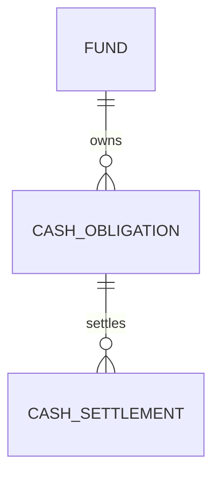

# Mutual Fund Investment Cash Flow

A fictional investment manager runs an equity fund and a bond fund. Fund Treasury needs to know whether each fund can meet its own cash needs when subscriptions, redemptions, and securities settlements land on different days. All funds, amounts, dealing NAVs, dates, and cash floors are synthetic.

| Layer | Grain | Purpose |
| --- | --- | --- |
| Approved cash obligation | One investor order, trade leg, coupon, or fee | Record direction, fund, expected date, and amount |
| Cash settlement | One cash posting against an obligation | Support partial settlement and a separate posting cutoff |
| Forecast event | One open obligation per scenario | Place remaining cash on the dealing calendar |
| Liquidity projection | One fund, scenario, and business day | Show inflows, outflows, closing cash, and the buffer shortfall |

Investor subscriptions and redemptions use approved units multiplied by the locked dealing NAV. Securities purchases and sales, coupon receipts, and fees use fixed cash amounts. The model adds posted settlements to each fund's opening cash and forecasts the remaining obligations. An unsettled overdue redemption moves to the next business day. The stress scenario delays subscription receipts by two business days and keeps outflow dates fixed.

## Run in Snowflake

Use an empty scratch schema and an active warehouse. Execute [schema](sql/01_schema.sql), [synthetic fixtures](sql/02_seed.sql), and [model](sql/03_model.sql) in order. Run the [release controls](sql/04_controls.sql) and confirm that each query returns zero rows, then run the [reports](sql/05_reporting.sql). Cash buffer gaps are business alerts and appear in the reports.

### Expected equity fund results

USD, using the June 30, 2025 posting cutoff. Equity starts the forecast at $800,000 and has an illustrative $200,000 minimum cash buffer.

| Business date | Base closing cash | Subscription-delay closing cash | Stress buffer gap |
| --- | ---: | ---: | ---: |
| July 1 | $870,000 | $550,000 | $0 |
| July 2 | $510,000 | $190,000 | $10,000 |
| July 3 | $670,000 | $670,000 | $0 |

The same $320,000 subscription arrives in both scenarios. Delaying it creates a one-day cash buffer breach even though both scenarios finish July 3 at the same balance. The bond fund has $800,000 at July 2 close under either scenario. The forecast calculates the equity shortfall independently of that cash.

See the [architecture decisions](docs/architecture.md) for cutoff and settlement rules and the [runbook](docs/runbook.md) for failure exercises.
